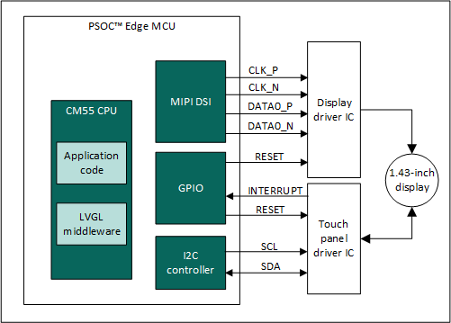
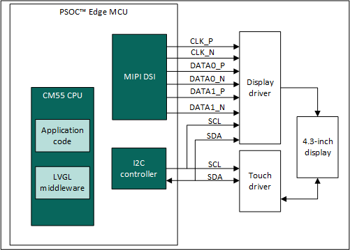
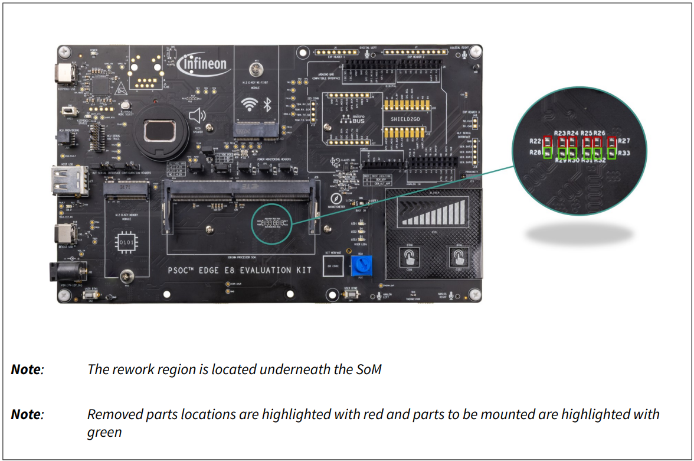
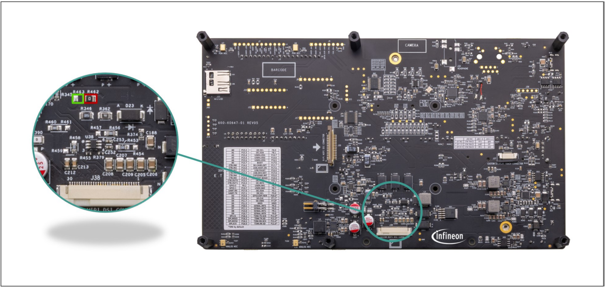
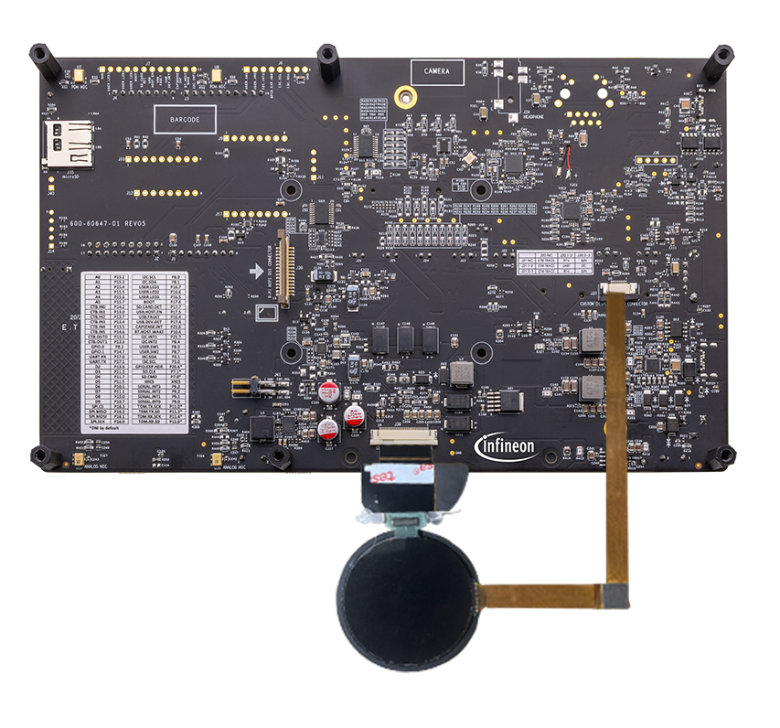
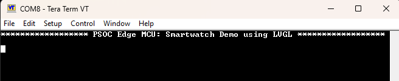
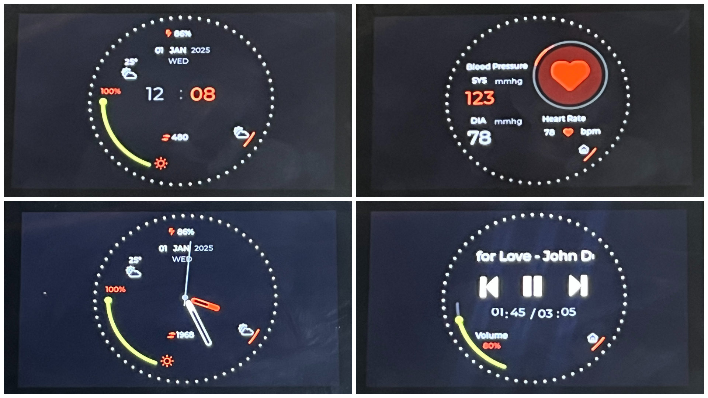
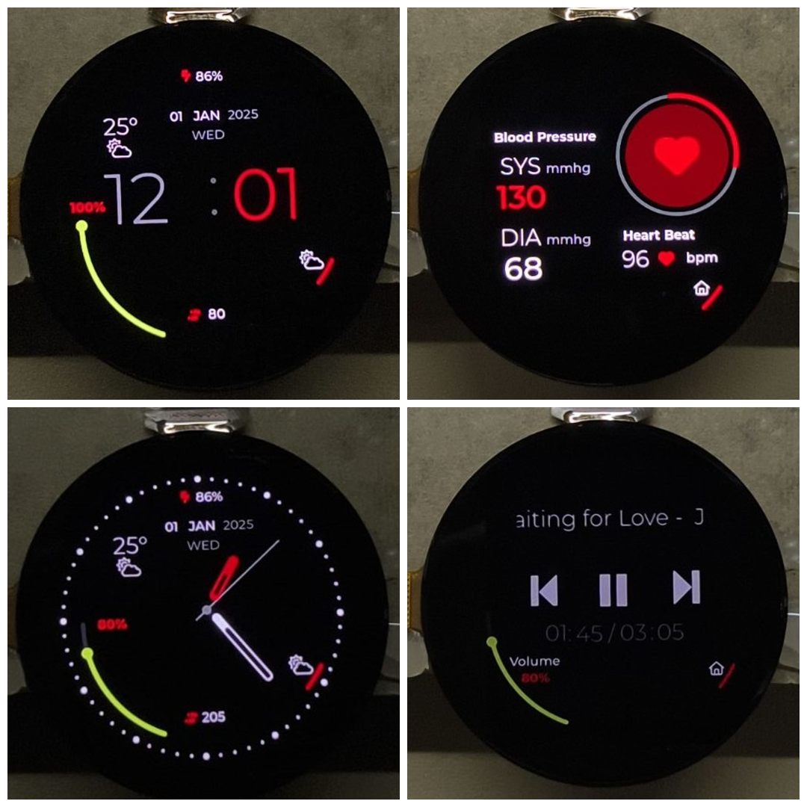
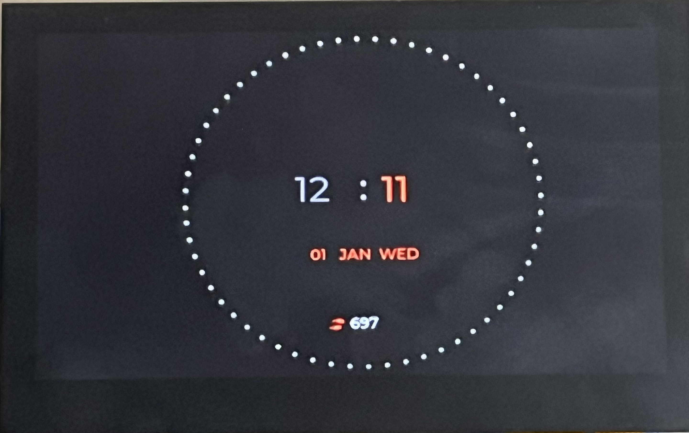
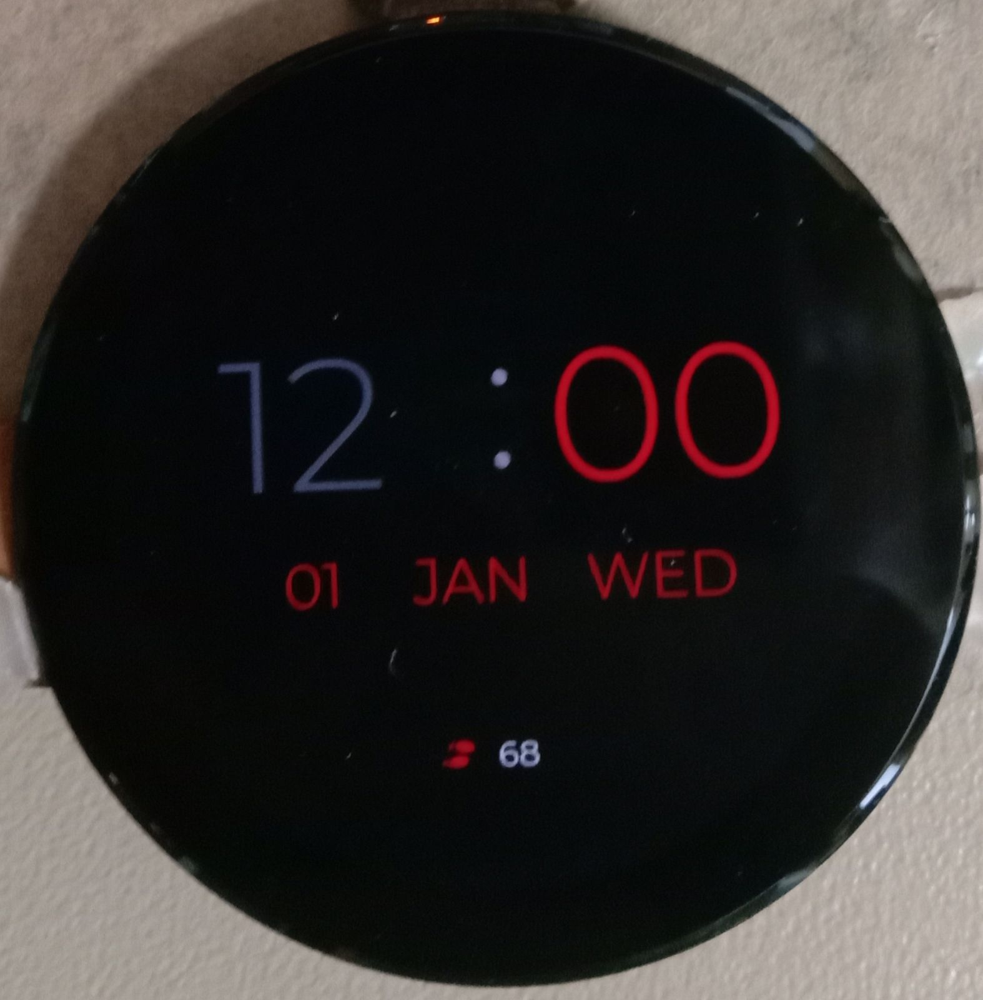

# PSOC&trade; Edge MCU: Smartwatch demo using LVGL

This code example highlights Infineon's comprehensive support for high-performance and low-power graphics applications on PSOC&trade; Edge MCU.
It showcases a Graphical User Interface (GUI) implementation of a smartwatch, primarily using a 1.43-inch round MIPI DSI AMOLED display in 466*466 resolution. It supports following two variants of round AMOLED panels:

**Table 1. Display panel details**

Display MPN | Display details | Manufacturer name | Manufacturer contact details
------------|-----------------|-------------------|-----------------------------
1.43” LTPS-AMOLED (Oncell) | 1.43-inch 466x466 AMOLED+CTP MIPI-DSI Display | DAS industry Limited | sales06@das-tek.com <br> https://www.dastek-lcd.com/ <br>
MTZ0143GF01AAA03AV1 | 1.43-inch 466x466 AMOLED+CTP MIPI-DSI Display | Microtech Technology Company Limited | sales11@microtech-lcd.com <br> https://www.microtech-lcd.com/ <br>

This code example also implements the emulation of the round smartwatch GUI in the same resolution on a 4.3-inch MIPI DSI Raspberry Pi DSI display. If you do not have access to the 1.43-inch display, you can run this code example on the 4.3-inch one, which is widely available to purchase from the Raspberry-Pi ecosystem. This application demonstrates the ability to leverage the Graphics Processing Unit (GPU) for high-performance GUI rendering, as well as a CPU-rendered low-power always-on screen.

> **Note:** This application builds for the 4.3-inch display by default.

   ```
   CONFIG_DISPLAY=RECTANGLE_4_3_INCH
   ```

   To build the application for aforementioned two different variants of the 1.43-inch display, set the following macro in *common.mk*:

   ```
   CONFIG_DISPLAY=DASTEK_ROUND_1_43_INCH
   ```
   or

   ```
   CONFIG_DISPLAY=MICROTECH_ROUND_1_43_INCH
   ```

Both the displays are interfaced to the PSOC&trade; Edge MCU using Mobile Industry Processor Interface Display Serial Interface (MIPI DSI). The GUI is powered by LVGL and developed using SquareLine Studio UI editor.

   **Figure 1. Block diagram**

    &nbsp;&nbsp;&nbsp;&nbsp;&nbsp;&nbsp;&nbsp;&nbsp;&nbsp;&nbsp;&nbsp;&nbsp;&nbsp;&nbsp;&nbsp;&nbsp;&nbsp;&nbsp;&nbsp;&nbsp;&nbsp;&nbsp;&nbsp;&nbsp; 

**Figure 1** shows the block diagram summarizing the system setup of the smartwatch graphics application.
The 1.43-inch display is interfaced using one-lane MIPI DSI in command mode whereas the 4.3-inch Raspberry-Pi display is interfaced using one-lane MIPI DSI in video mode.
Configuration data is sent to 4.3-inch display through the I2C lines during initialization.
The touch panel driver ICs of both the displays are interfaced using the I2C protocol for reading the touch coordinates.
For 1.43-inch display, GPIOs are used for interfacing Interrupt and Reset lines of display and touch panels.
The 4.3-inch display's touch panel interrupt line is not connected to the PSOC&trade; Edge Evaluation Kit. The touch data is polled by the firmware at regular intervals.
The firmware executes on the CM55 CPU.

[View this README on GitHub.](https://github.com/Infineon/mtb-example-psoc-edge-gfx-lvgl-smartwatch)

[Provide feedback on this code example.](https://yourvoice.infineon.com/jfe/form/SV_1NTns53sK2yiljn?Q_EED=eyJVbmlxdWUgRG9jIElkIjoiQ0UyNDIyMTYiLCJTcGVjIE51bWJlciI6IjAwMi00MjIxNiIsIkRvYyBUaXRsZSI6IlBTT0MmdHJhZGU7IEVkZ2UgTUNVOiBTbWFydHdhdGNoIGRlbW8gdXNpbmcgTFZHTCIsInJpZCI6InNhbmplZXYubWFqdW1kYXJAaW5maW5lb24uY29tIiwiRG9jIHZlcnNpb24iOiIyLjIuMSIsIkRvYyBMYW5ndWFnZSI6IkVuZ2xpc2giLCJEb2MgRGl2aXNpb24iOiJNQ0QiLCJEb2MgQlUiOiJJQ1ciLCJEb2MgRmFtaWx5IjoiUFNPQyJ9)

See the [Design and implementation](docs/design_and_implementation.md) for the functional description of this code example.


## Requirements

- [ModusToolbox&trade;](https://www.infineon.com/modustoolbox) v3.7 or later (tested with v3.8)
- Board support package (BSP) minimum required version: 1.1.0
- Programming language: C
- Associated parts: All [PSOC&trade; Edge MCU](https://www.infineon.com/products/microcontroller/32-bit-psoc-arm-cortex/32-bit-psoc-edge-arm) parts


## Supported toolchains (make variable 'TOOLCHAIN')

- GNU Arm&reg; Embedded Compiler v14.2.1 (`GCC_ARM`) – Default value of `TOOLCHAIN`
- Arm&reg; Compiler v6.22 (`ARM`)
- IAR C/C++ Compiler v9.50.2 (`IAR`)
- Arm&reg; Toolchain for Embedded v22.1 (`LLVM_ARM`)

> **Note:** The IAR builds use LVGL's portable C software-renderer fallback instead of the Helium assembly path because the LVGL Helium assembly sources are not compatible with the IAR assembler. Application behavior is unchanged, and VG-Lite GPU acceleration remains enabled.


## Supported kits (make variable 'TARGET')

- [PSOC&trade; Edge E84 Evaluation Kit](https://www.infineon.com/KIT_PSE84_EVAL) (`KIT_PSE84_EVAL_EPC2`) – Default value of `TARGET`
- [PSOC&trade; Edge E84 Evaluation Kit](https://www.infineon.com/KIT_PSE84_EVAL) (`KIT_PSE84_EVAL_EPC4`)


## Hardware setup

This example uses the board's default configuration. See the kit user guide to ensure that the board is configured correctly.

Ensure the following jumper and pin configuration on board.
- BOOT SW must be in the HIGH/ON position
- J20 and J21 must be in the tristate/not connected (NC) position

### Supported display and electrical connection with KIT_PSE84_EVAL

1. **Waveshare 4.3 inch Raspberry Pi DSI 800*480 pixel display:** This display is supported by default <br>

   Connect the FPC 15-pin cable between the display connector and the PSOC&trade; Edge E84 evaluation kit's RPI MIPI DSI connector as shown in **Figure 2** <br>

   **Table 2: PSOC&trade; Edge E84 Evaluation Kit connections**

   Display's connector | PSOC&trade; Edge E84 Evaluation Kit's connector
   --------------------|----------------------------------------
   DSI connector       | J39

   **Figure 2. 4.3-inch display connection with PSOC&trade; Edge E84 Evaluation Kit**

   

   <br>

2. **1.43-inch 466*466 pixel round AMOLED display:** This setup requires rework on the PSOC&trade; Edge E84 Evaluation Kit, and the rework instructions are as follows:

   - **Remove:** R22, R23, R24, R25, R26, R27, R462

   - **Populate:** R28, R29, R30, R31, R32, R33, R463

   **Figure 3. Rework on the top side of the PSOC&trade; Edge E84 baseboard**

   

   **Figure 4. Rework on the bottom side of the PSOC&trade; Edge E84 baseboard**

   

   Connect the 1.43-inch display to the PSOC&trade; Edge E84 Evaluation Kit following the connections listed in **Table 3** and illustrated in **Figure 5**.<br>

   **Table 3: PSOC&trade; Edge E84 Evaluation Kit connections**

   Display's connector | PSOC&trade; Edge E84 Evaluation Kit's connector
   --------------------|----------------------------------------
   DSI connector       | J38
   Touch connector     | J37

   **Figure 5. 1.43-inch display connection with PSOC&trade; Edge E84 Evaluation Kit**

   

<br>

## Software setup

See the [ModusToolbox&trade; tools package installation guide](https://www.infineon.com/ModusToolboxInstallguide) for information about installing and configuring the tools package.

Install a terminal emulator if you do not have one. Instructions in this document use [Tera Term](https://teratermproject.github.io/index-en.html).

This example requires no additional software or tools.

## Operation

See [Using the code example](docs/using_the_code_example.md) for instructions on creating a project, opening it in various supported IDEs, and performing tasks, such as building, programming, and debugging the application within the respective IDEs.

1. Ensure that the 4.3-inch Raspberry-Pi TFT display/1.43-inch AMOLED display is connected to the board as per the [Display setup](#supported-display-and-electrical-connection-with-kit_pse84_eval) section

2. Connect the board to your PC using the provided USB cable through the KitProg3 USB connector

3. Open a terminal program and select the KitProg3 COM port. Set the serial port parameters to 8N1 and 115200 baud

4. In the common makefile - _<application\>/common.mk_, set the value of the `CONFIG_DISPLAY` variable to one of the display options mentioned below to enable the corresponding display and touch drivers for the application. The same information is provided in the comments within the common makefile.

   - **Waveshare 4.3-inch Raspberry Pi DSI LCD Display (MTB_DISPLAY_W4P3INCH) and it's touch panel (MTB_CTP_FT5406):** This is enabled by default<br>
      `RECTANGLE_4_3_INCH`

   - **Dastek 1.43-inch 466*466 round MIPI DSI command mode display (MTB_DISPLAY_CO5300) and it's touch panel (MTB_CTP_FT6146):**<br>
      `DASTEK_ROUND_1_43_INCH` <br>

   - **Microtech 1.43-inch 466*466 round MIPI DSI command mode display (MTB_DISPLAY_CO5300) and it's touch panel (MTB_CTP_FT3268):**<br>
      `MICROTECH_ROUND_1_43_INCH` <br>

      > **Note:** From the above set, only one display and it's touch driver set should be enabled in the _common makefile_ at a time.

   **Example**:

     - To use the Waveshare 4.3-inch Raspberry Pi DSI LCD display:

       ```
       CONFIG_DISPLAY = RECTANGLE_4_3_INCH
       ```

       or

     - To use the 1.43 inch round display:

       ```
       CONFIG_DISPLAY = DASTEK_ROUND_1_43_INCH
       ```

       or

       ```
       CONFIG_DISPLAY = MICROTECH_ROUND_1_43_INCH
       ```

5. Build the application

6. After programming, the application starts automatically. Confirm that "PSOC&trade; Edge MCU: Smartwatch Demo using LVGL" is displayed on the UART terminal

   **Figure 6. Terminal output on program startup**

   

7. The smartwatch application operates in three states - high-performance, low-power, and ultra-low power. <br> For the 1.43-inch round display, the application state is changed from high-performance to low-power and finally to ultra-low power after 30 seconds of inactivity. The application state can be brought back to high-performance by a simple touch activity. <br> For the 4.3-inch display, the state transition is done by pressing the USER BTN1 (SW2) on the kit

8. Observe that on start up, the display shows high-performance GUI for a Smartwatch. You can use the touch screen to perform various actions such as swiping up to see health screen and then music screen, clicking home button to go back to digital clock screen, swiping right to analog clock screen, click weather icon to show weather screen and finally swiping right in weather screen will change to forecast screen. The screenshots of the GUIs are shown in **Figure 7** and **Figure 8**

   **Figure 7. 4.3-inch high-performance UIs**

   

   **Figure 8. 1.43-inch high-performance UIs**

   

9. For 4.3-inch display, press the user button (SW2) to switch to the low-power state and show the "Always-ON" display. Press the button once again to enter the ultra-low power state and turn off the display

   **Figure 9. 4.3-inch Always-ON UI**

   

10. For 1.43-inch, after 30 seconds of inactivity, the application state changes to low-power state and the "Always-ON" GUI of the Smartwatch is displayed as shown in **Figure 10**. After further 30 seconds of inactivity, the device enters the ultra-low power and the display is turned off

    **Figure 10. 1.43-inch Always-ON UI**

    

## Related resources

Resources  | Links
-----------|----------------------------------
Application notes  | [AN235935](https://www.infineon.com/AN235935) – Getting started with PSOC&trade; Edge E8 MCU on ModusToolbox&trade; software <br> [AN239191](https://www.infineon.com/AN239191) – Getting started with graphics on PSOC&trade; Edge MCU
Code examples  | [Using ModusToolbox&trade;](https://github.com/Infineon/Code-Examples-for-ModusToolbox-Software) on GitHub
Device documentation | [PSOC&trade; Edge MCU datasheets](https://www.infineon.com/products/microcontroller/32-bit-psoc-arm-cortex/32-bit-psoc-edge-arm#documents) <br> [PSOC&trade; Edge MCU reference manuals](https://www.infineon.com/products/microcontroller/32-bit-psoc-arm-cortex/32-bit-psoc-edge-arm#documents)
Development kits | Select your kits from the [Evaluation board finder](https://www.infineon.com/cms/en/design-support/finder-selection-tools/product-finder/evaluation-board)
Libraries  | [mtb-dsl-pse8xxgp](https://github.com/Infineon/mtb-dsl-pse8xxgp) – Device support library for PSE8XXGP <br> [retarget-io](https://github.com/Infineon/retarget-io) – Utility library to retarget STDIO messages to a UART port
Tools  | [ModusToolbox&trade;](https://www.infineon.com/modustoolbox) – ModusToolbox&trade; software is a collection of easy-to-use libraries and tools enabling rapid development with Infineon MCUs for applications ranging from wireless and cloud-connected systems, edge AI/ML, embedded sense and control, to wired USB connectivity using PSOC&trade; Industrial/IoT MCUs, AIROC&trade; Wi-Fi and Bluetooth&reg; connectivity devices, XMC&trade; Industrial MCUs, and EZ-USB&trade;/EZ-PD&trade; wired connectivity controllers. ModusToolbox&trade; incorporates a comprehensive set of BSPs, HAL, libraries, configuration tools, and provides support for industry-standard IDEs to fast-track your embedded application development

<br>


## Other resources

Infineon provides a wealth of data at [www.infineon.com](https://www.infineon.com) to help you select the right device, and quickly and effectively integrate it into your design.


## Document history

Document title: *CE242216* – *PSOC&trade; Edge MCU: Smartwatch demo using LVGL*

 Version | Description of change
 ------- | ---------------------
 1.x.0   | New code example <br> Early access release
 2.0.0   | GitHub release
 2.0.1   | Performance improvement in 4.3-inch display usecase
 2.1.0   | Updated design files to fix ModusToolbox&trade; v3.7 build warnings
 2.2.0   | Added support for LVGL v9.5.0
 2.2.1   | Updated the linker script to support LLVM ATfE v22.1.0
<br>


All referenced product or service names and trademarks are the property of their respective owners.

The Bluetooth&reg; word mark and logos are registered trademarks owned by Bluetooth SIG, Inc., and any use of such marks by Infineon is under license.

PSOC&trade;, formerly known as PSoC&trade;, is a trademark of Infineon Technologies. Any references to PSoC&trade; in this document or others shall be deemed to refer to PSOC&trade;.

---------------------------------------------------------

(c) 2024-2026, Infineon Technologies AG, or an affiliate of Infineon Technologies AG. All rights reserved.
This software, associated documentation and materials ("Software") is owned by Infineon Technologies AG or one of its affiliates ("Infineon") and is protected by and subject to worldwide patent protection, worldwide copyright laws, and international treaty provisions. Therefore, you may use this Software only as provided in the license agreement accompanying the software package from which you obtained this Software. If no license agreement applies, then any use, reproduction, modification, translation, or compilation of this Software is prohibited without the express written permission of Infineon.
<br>
Disclaimer: UNLESS OTHERWISE EXPRESSLY AGREED WITH INFINEON, THIS SOFTWARE IS PROVIDED AS-IS, WITH NO WARRANTY OF ANY KIND, EXPRESS OR IMPLIED, INCLUDING, BUT NOT LIMITED TO, ALL WARRANTIES OF NON-INFRINGEMENT OF THIRD-PARTY RIGHTS AND IMPLIED WARRANTIES SUCH AS WARRANTIES OF FITNESS FOR A SPECIFIC USE/PURPOSE OR MERCHANTABILITY. Infineon reserves the right to make changes to the Software without notice. You are responsible for properly designing, programming, and testing the functionality and safety of your intended application of the Software, as well as complying with any legal requirements related to its use. Infineon does not guarantee that the Software will be free from intrusion, data theft or loss, or other breaches (“Security Breaches”), and Infineon shall have no liability arising out of any Security Breaches. Unless otherwise explicitly approved by Infineon, the Software may not be used in any application where a failure of the Product or any consequences of the use thereof can reasonably be expected to result in personal injury.
